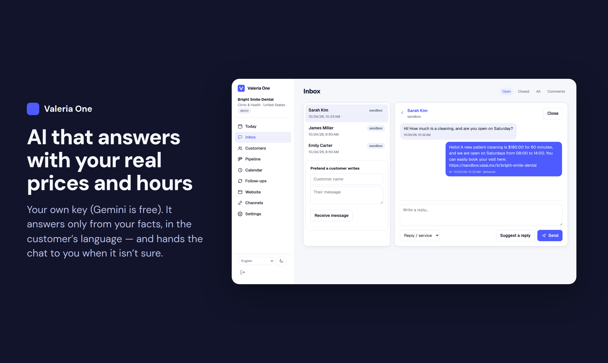
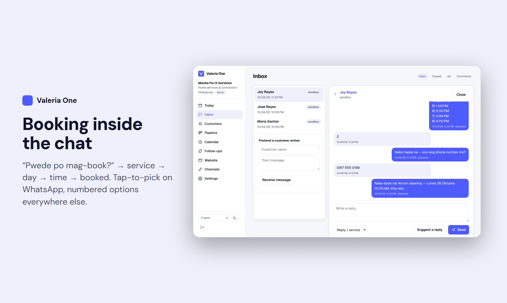
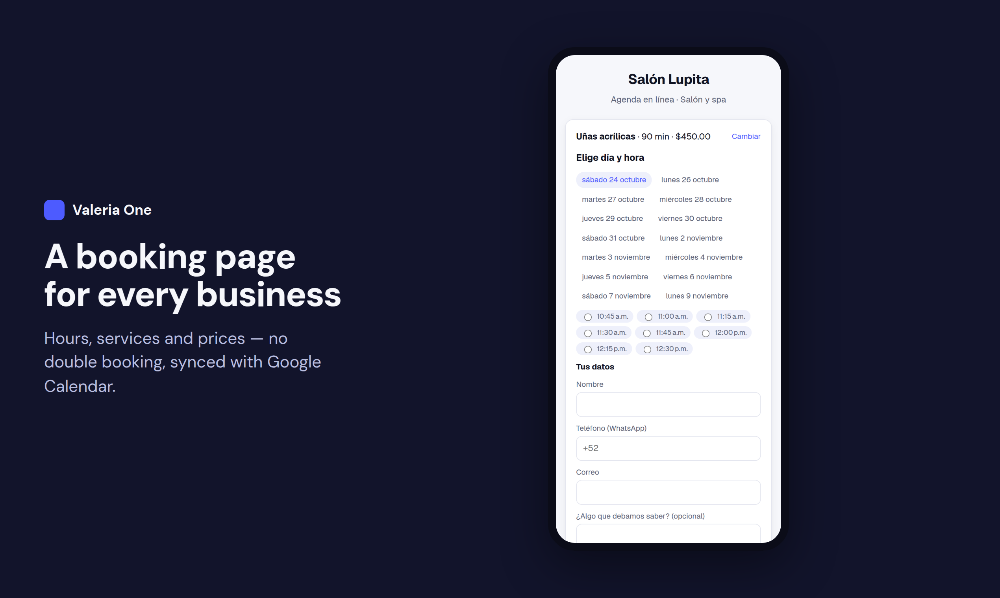
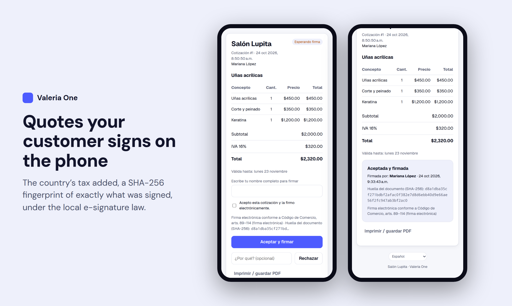
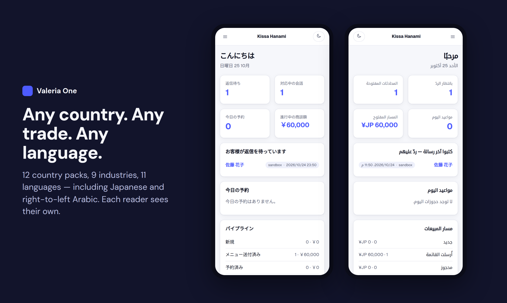
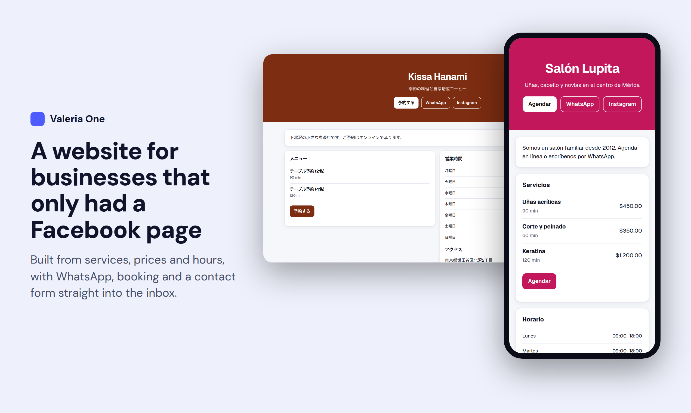

# Valeria One

**The back office for any business, in any country, on any channel.**



Across most of the world a Facebook page *is* the website and WhatsApp *is* the front desk. Millions of
small businesses sell that way, but nobody gave them the office behind it: leads get buried in DMs,
follow-ups are forgotten, and the business owns nothing if the page goes down.

Valeria One is that office:

- **Sign up with the accounts you already have.** *Continue with Facebook* (or Google): no form, no password;
  the business arrives filled in from its Facebook Page (name, phone, email, address, hours) with its Messenger
  and Instagram already in the inbox. Then one **Connect** screen: WhatsApp, Facebook + Instagram, email,
  payments, calendar, website, TikTok, Google Business Profile and the directory, each a tap or a short form,
  all on the business's own accounts.
- **One inbox for every channel.** WhatsApp, Messenger, Instagram, SMS (any provider), email, Telegram,
  or anything else through a signed webhook. The core never knows which pipe a message used.
- **Customers.** One record per person, however they reach you, with consent tracked the way each
  country's law requires.
- **Deals and pipeline** in the words of your trade: a salon's *packages*, a contractor's *jobs*,
  a clinic's *treatment plans*.
- **Appointments** with no double-booking, and a **public booking page** (`/b/your-business`): customers pick a
  service, a day and a time on their phone; it is checked again under a lock so two people never get the same slot.
- **A website for businesses that have none** (`/s/your-business`): built from services, prices, hours and booking,
  with WhatsApp / Instagram / Facebook buttons, a map, a contact form straight into the inbox, and schema.org
  data so search engines understand it.
- **Payments with the business's own account**, per country: Stripe, Mercado Pago (incl. Pix), PayMongo (GCash,
  Maya), Paystack, Razorpay (incl. UPI), M-Pesa (STK push), MTN MoMo, or bank transfer. Payment links sent in the chat; provider webhooks verified
  and applied once. Valeria One never holds the money.
- **Quotes with e-signature**: itemised, the country's tax added, frozen with a SHA-256 fingerprint; the customer
  signs on their phone by typing their name; who, when, IP, device and fingerprint are kept, under the country's
  e-signature law (ESIGN/UETA, eIDAS, Código de Comercio…).
- **Follow-ups and campaigns**: reminders before appointments, thank-yous after, welcomes, deal-won messages, and
  campaigns to customers who agreed — through one outbox, with quiet hours, consent and WhatsApp template rules.
- **Booking inside the chat** on any channel: "quiero una cita" / "book" / "予約" walks the customer through service,
  day and time (tap-to-pick lists on WhatsApp, numbered options elsewhere), in their language.
- **Two-way Google Calendar**: appointments appear in the owner's calendar; time they block there is never
  offered on the booking page (`python -m valeria_one.jobs calendar` every minute pushes changes).
- **AI replies with the business's own key** (Google Gemini — free —, Anthropic Claude or OpenAI): suggests
  replies or answers on its own using only the business's services, prices, hours and booking link, in the
  customer's language; hands the chat to a person when unsure, upset or off-topic. A business assistant, not a
  general chatbot.
- **Comment to private message**: "precio?" under a Facebook or Instagram post gets one private answer by keyword rules.
- **Missed-call text-back** on the business's own Twilio number: the owner's phone rings first (optional); if nobody
  answers, the caller gets a text in seconds and the conversation lands in the inbox.
- **Review requests**: the same polite ask to every customer (no gating), one tap or after each appointment, once
  every 90 days, with counted clicks to the business's Google review page.
- **Grow: customers back + bring a friend.** Customers who have gone quiet (no visit, booking, payment or message
  in 60 days — the owner's number) get ONE friendly message on their channel, with the owner's offer and the
  booking link: once a day, a daily cap, never again within 180 days, only with promotions consent, through the
  same outbox and rules as every follow-up. The owner sees who went quiet, a preview, and who replied or came
  back. Each customer also gets a personal link (`/f/…`) to share: a friend who books, writes or leaves a number
  is recorded with both rewards the owner set ("a free haircut", "10% off"), to give and tick off. Rewards are
  never tied to reviews.
- **A public directory: "find a business near you"** (`/directory`): search by words, type, city and country;
  each listed business gets a fast, server-rendered page with schema.org LocalBusiness data, its hours, its
  Google rating, its booking page and website, and a contact form that lands in its inbox as a new customer
  (source *directory*). Off until the owner lists the business; nothing personal shown unless the owner ticks it;
  practice (sandbox) businesses never appear.
- **Google Business Profile** with the business's own profile: its reviews arrive every 30 minutes and are answered
  from Valeria One (the AI may draft; nothing goes to Google without the owner's approval), posts on the profile,
  the name, hours and phone Google shows, and 30 days of calls, website clicks, directions and views. Google's
  limits are kept (10 changes a minute, a pause after a 429); see [docs/GOOGLE_SETUP.md](docs/GOOGLE_SETUP.md).
- **Posts, written by AI, approved by the owner**: one idea becomes a version for the Facebook Page, Instagram and
  Google, in the business's language and tone; publish now or schedule, with a calendar of what is coming, what
  went out and what didn't (and why). Never published twice; Instagram's daily quota checked first.
- **TikTok inbox** (Business Messaging): TikTok direct messages in the same inbox, customers and AI auto-reply,
  with TikTok's rules kept (they write first; answers within 48 h; tokens renewed by themselves). See
  [docs/TIKTOK_SETUP.md](docs/TIKTOK_SETUP.md).
- **Valeria, your assistant — on your own WhatsApp.** Link your phone once (send a one-time code to your business's
  WhatsApp or Telegram, or type your number) and talk to her like to a person: "today", "anything new?", "reply Ana: see
  you at 5", "who hasn't come back?", "move Luis to 4pm", "block 2 to 4", "ask yesterday's customers for a review",
  "who owes me?", "send Juan a payment link for 500", "we close at 6 on Saturday", "what did you do today?", a photo to
  post, a voice note, "stop", "undo". Only registered numbers are commands (staff numbers with their own permissions);
  everyone else is a customer. With the business's own AI key (Gemini's free tier works) she understands any language
  mix and voice notes; without one, keyword rules in all 11 languages, and 2–3 taps when she isn't sure. Anything for a
  customer she asks first ("1 yes 2 no 3 later") until the owner lets her do that kind of thing by herself; money,
  prices, promos and cancellations always ask. Approved sends wait a minute ("undo" stops them). An 08:00 summary, a
  Monday **proof** (one honest number she caused: customers back, visits booked in chat, bookings confirmed, reviews
  page opened, voice notes answered), **slow-day** offers to regulars (asked, never sent alone), a **holiday** calendar
  for MX, PH, IN, US, AE, PK, NG, ID and BR (a post offered a week before), **loyalty without cards** (every Nth visit
  gets a reward, off until set), **24/7 answers** from the owner's own facts only, **reminders** with "reply 1 to
  confirm, 2 to change", and **pay by link** from the business's own payment account. She **talks like the owner**
  (formal / friendly / super casual, learned from their edits) and never nags: one question at a time, quiet after two
  unanswered. **Voice notes** from customers are written down in the inbox with a suggested reply.
- **"Help me set it up"**: an owner can ask for a local helper (matched by country, city and language, with ratings)
  and shares their name, business, city and needs only after saying yes. Helpers sign up at `/helpers` and are approved
  on the Server page; what a lead would cost is only recorded (first 5 free) — Valeria One stays free.
- **Any country, from day one.** Language, currency, tax, phone format, time zone, messaging law,
  privacy law, e-signature law and invoicing live in a *country pack* (a YAML file), not in code. A country
  without one still signs up: its pack is made from world data (Unicode CLDR, libphonenumber) with strict
  defaults (marketing only with consent, none at night, no tax added, bank transfer or cash to get paid), and
  the server's admin is told when the first business from it arrives. The owner picks any currency, any of the
  screen languages, and can download all the business's data at any time; every business gets its own
  privacy notice page.
- **A public API** with per-business keys, an audit trail of every action, and privacy erasure built in.
- **Outgoing webhooks**: every event, signed, delivered from a transactional outbox with retries for a day.
- **Teams**: invite by link; staff work the inbox, customers, deals and calendar; owners keep settings, channels,
  keys, AI and the team. One person can belong to several businesses and switch between them.
- **Only what you use.** Every part beyond the inbox and customers is a *block* the owner switches on or off;
  off means hidden and silent (no reminders, no auto-replies, no public page). And every business can call
  things its own words: *members*, *jobs*, *patients*, its own pipeline stages.
- **Works without AI.** Rules handle booking, reminders and comment replies; AI is optional, with your own key.
- **Your own server in five minutes**, with nightly backups and updates that roll back by themselves if they
  fail. See [docs/SELF_HOST.md](docs/SELF_HOST.md).
- **For hosts and agencies**: a [Partner API](docs/PARTNER_API.md) to create, pause, resume and bill the
  businesses you run for your customers, from your own control panel.

Valeria One is built to sit behind Meta's business messaging: Meta's Business Agent answers the chat;
Valeria One runs the business after it. See [docs/META.md](docs/META.md).

Created by **Tadewan Pascua** — tad.pascua@valai.mx

## Screens

Business owners get a web app (desktop and phone, light and dark) in **11 languages** — English, Español, Português,
Français, Deutsch, Filipino, Bahasa Indonesia, हिन्दी, العربية (right-to-left), 日本語, 中文 — following each reader's own
language (a Japanese employee of a Mexican salon sees Japanese). Add a language by adding one file in
`valeria_one/web/locales/` (translations welcome; native-speaker reviews especially):
**Today** (who is waiting for an answer, today's appointments, open pipeline) · **Valeria** (talk to her, her
questions, your phone, how you sound, what she may do alone, reminders, loyalty, holidays) · **Connect** (every account in one
screen, and an invite link to share) · **Inbox** (every channel in
one list, the country's sending rules explained in plain words) · **Customers** · **Pipeline** (a board in the
words of your trade: drag cards with a mouse or a finger, arrow keys, or "Move to…"; or a list) · **Tasks** (list or
To do / Doing / Done board) · **Calendar** · **Automations** · **Forms** · **Channels** · **Settings** (your country's
rules, your own fields, API keys).

**Your own fields** (v0.16): up to 20 on customers and 20 on deals — words, number, money, date, yes/no, pick-one,
phone, link — added one question per screen, checked by type, edited right on the page, shown in the lists and on
the board's cards, searchable, in the CSV files (customers in and out, deals out) and the API (`custom`,
`GET /v1/fields`, `?field=&value=`). Deleting one asks first and keeps its answers 30 days for undo.
**Automations** — "when this, do that": a gallery switched on with one tap (a reply task for every new lead, a
thank-you when a deal is won, tag who booked, tell me when someone has waited 2 hours…) or your own from dropdowns —
one trigger (new lead, deal moves to a stage, booking, a field changes, a form is sent, no answer for N hours), one
optional "only if", up to three actions (tag, give to someone, add a task, move the deal, start a deal, tell me on
Valeria, message the customer). Each runs once per event, stops itself if it would loop, and writes down what it did.
Messages to customers ask you first unless you allow it, and always follow consent, STOP and the 24-hour window.
**Forms**: pick the questions (including your own fields), the thank-you words and where a lead lands; share the link
`/form/<name>` on WhatsApp, paste the embed on your own site, or show it on your Valeria One website and directory
listing. It wears your business's look; what people send lands in the inbox (one customer per phone or email), with
separate boxes for "answer my request" and "send me offers".

**Campaigns** (v0.18) — one message to your own customers by WhatsApp, text or email, built one question per screen:
where → who (tags, one of your fields, a deal stage, where they came from, last visit; it shows how many are left out
and why) → the message (an email block editor — title, text, picture, button — or "let Valeria write it" in your
style with your own AI key) → look at it and *send me a test* → now or later. Only customers who said yes to offers;
every message has a way out (unsubscribe link and one-click header; Reply STOP); nothing at night; at most one offer a
day and three a week; WhatsApp only with your approved template outside the 24-hour window; a few a minute, never
twice. Numbers: sent, delivered, opened (only if you switch it on), clicked, replied, unsubscribed, and bookings and
payments in the next 7 days. **Sequences** (drips): a few messages with waits, for each new lead, form, tag or
booking — they stop when the customer replies, books or unsubscribes.
**Workflows** — "when this happens, then these steps": messages, tags, fields, a deal moved, a to-do, a sequence,
a word to you, *wait* minutes/hours/days or *until a date* (birthdays), *if / else* on a tag, a field, the channel
or a reply, and a goal (booked, paid, replied) that ends the run. On a phone it's a list with "+ add step"; ready-made
ones for new-lead follow-up, missed visits, a review after each visit (the same ask for everyone), birthdays and
win-backs. Any automation opens as a workflow.
**Phone agent** — your own Twilio number answers calls with your own AI key: prices, hours and directions from what you
entered, bookings in your free times, messages, putting the caller through to you, and "someone will call you back"
(a to-do and a word to you) for anything it doesn't know. Recording only if you choose, always announced. Every call
is on the customer's page with what was said.
**Invoices** — numbered for you, your country's tax, from an accepted quote in one tap, sent by WhatsApp or email
with a pay link from your own payment account, a page the customer can print or save as PDF, paid when the link is
paid, overdue reminders that ask you first. **Subscriptions**: a plan (an amount every week, month or year), an
invoice each period, pause or cancel, monthly recurring revenue on Today.
**Ready setups** — "What kind of business? Set it all up for me": fields, automations, workflows, a welcome sequence, a
campaign draft, a form, saved replies, services and hours for salons, clinics, florists, restaurants, real estate,
design studios, gyms, home services, shops and any business. You see everything first; nothing you have is changed;
undo for 24 hours. Download your own setup (never your customers) or copy it into another business of yours.
**The app** — install it on your phone or computer (Android, iPhone, desktop); notifications by Web Push; the Play
Store and App Store routes are in [docs/APP_STORES.md](docs/APP_STORES.md).

**Projects** — for any business that delivers work in stages (interior design, architecture, remodelling, events,
contractors): rooms or areas with measurements and photos, selections the customer approves or declines from their
phone, a live budget meter, quotes made from the approved pieces, purchase orders to suppliers, tasks, install and
punch lists, hours, and a **customer portal** at `/portal/<token>` (no password: the link is sent by WhatsApp).
**Design studio** (on for the interior-design pack, a switch for everyone else): free-form mood boards, an **AI
visualizer** that redesigns the customer's real room from a photo (with the business's own Gemini or OpenAI key),
2D floor plans to scale, colour palettes taken from photos, a one-tap client presentation (PDF) and a spec sheet
for installers. **AI team**: design assistant, project coordinator, collections and marketing helpers that draft
— a person always sends. Finished projects can go on the business's website, with an optional "see your space in
our style" preview for visitors.

## Screenshots

| | |
|---|---|
|  |  |
|  |  |
|  | |

## Try it

**Live sandbox: https://sandbox.valai.mx** — open a demo business in one click, or get your own.
It is filled with fake businesses (a salon in Mérida, a dentist in Chicago, a repair
service in Manila, a realtor in São Paulo, a café in Tokyo, a florist in London, a gym in Lagos, a law
firm in Bogotá, a yoga studio in Berlin). Nothing you do there sends a real message.

```bash
# get your own throwaway business and key
curl -X POST https://sandbox.valai.mx/v1/sandbox/signup -H 'Content-Type: application/json' \
     -d '{"name": "My Shop", "country": "PH", "industry": "shop"}'

# a customer writes in
curl -X POST https://sandbox.valai.mx/v1/sandbox/simulate -H "Authorization: Bearer vo_test_…" \
     -H 'Content-Type: application/json' -d '{"from": "cust-1", "name": "Maria", "body": "Magkano po?"}'

# see the inbox, answer
curl https://sandbox.valai.mx/v1/conversations -H "Authorization: Bearer vo_test_…"
```

Interactive API docs: `https://sandbox.valai.mx/docs`.

## Use it free

The hosted Valeria One at [valeriaone.valai.mx](https://valeriaone.valai.mx) is free for everyone, in any
country: everything included, for the whole team, no card.

## Run it yourself

On a fresh Ubuntu or Debian server:

```bash
curl -fsSL https://raw.githubusercontent.com/valeriaone/valeria-one/main/deploy/install.sh | sudo bash
```

It prints a one-time link to create the first account. Domain + HTTPS, backups, restore and updates:
[docs/SELF_HOST.md](docs/SELF_HOST.md). One-click images for cloud marketplaces: [deploy/marketplace](deploy/marketplace/README.md).

By hand with Docker: `cp .env.example .env`, fill it in, `docker compose up -d` (the database is migrated on start).

For development, without Docker: Python 3.11+, PostgreSQL 13+.

```bash
python -m venv .venv && .venv/bin/pip install -e '.[test]'
.venv/bin/alembic upgrade head
.venv/bin/uvicorn valeria_one.api:app
.venv/bin/pytest
```

## Packs

| | |
|---|---|
| Countries | reviewed packs: MX, US, PH, BR, CO, ES, DE, GB, IN, NG, KE, UG, AU, JP · every other country: safe defaults |
| Industries | generic, salon, clinic, contractor, realtor, shop, restaurant, fitness, professional |
| Channels | whatsapp, messenger, instagram, tiktok, sms (Twilio), email, telegram, viber, webhook (anything), sandbox |

Add a country: copy `valeria_one/packs/countries/MX.yaml`, change the values, open a pull request.
The legal fields in every pack are a starting point (`reviewed_by_counsel: false`) — not legal advice.

## Architecture

See [docs/ARCHITECTURE.md](docs/ARCHITECTURE.md).

## License

Valeria One is free software under the **GNU AGPL-3.0** ([LICENSE](LICENSE)). If you run a modified
version as a service, you must offer your users its source code. **Commercial licenses** are available
from the author for use without the AGPL obligations.

"Valeria One" is a trademark of Tadewan Pascua ([TRADEMARK.md](TRADEMARK.md)).

## Contact

Tadewan Pascua, creator of Valeria One — **tad.pascua@valai.mx** · https://www.linkedin.com/in/tad-pascua-a1b38937/
